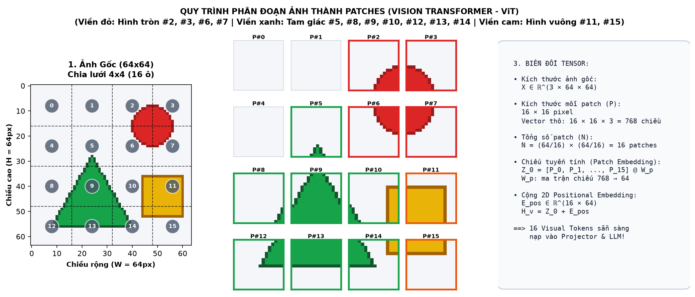

# Nghiên cứu & Thực nghiệm: Mô hình Thị giác Lớn (Vision-Language Models — VLM)

Gói tài liệu và mã nguồn thực nghiệm chuyên sâu phục vụ nghiên cứu các nguyên lý cốt lõi, kiến trúc nền tảng và cơ chế vận hành của **Mô hình Thị giác - Ngôn ngữ Lớn (Vision-Language Models — VLM / LVLM)**.

Dự án cung cấp bộ tài liệu, dữ liệu và mã nguồn hoàn chỉnh gồm:
- **Tài liệu nghiên cứu chuyên sâu 10 chuyên đề:** [docs/VLM.md](docs/VLM.md) — Phân tích chi tiết 10 chuyên đề theo đúng dàn ý lý thuyết, công thức toán học và kiến trúc kỹ thuật.
- **Notebook thực nghiệm toàn trình:** [notebook/vlm_demo.ipynb](notebook/vlm_demo.ipynb) — Mô phỏng trực quan từ khâu cắt Patch ảnh, chiếu đặc trưng (Projector), tính toán ma trận Attention xuyên phương thức thật (Cross-Modal Attention Heatmap), vòng lặp sinh tự hồi quy từng bước đến đánh giá ảo giác qua POPE Benchmark.
- **Dữ liệu mẫu và minh họa trực quan:** [data/](data/) — Chứa các tệp ảnh mẫu có kiểm soát ground-truth, thư mục 16 patches độc lập và sơ đồ trực quan hóa pipeline.
- **Dữ liệu đo lường đầu ra:** [output/](output/) — Bảng kết quả đo lường định lượng trên các tập mẫu thử nghiệm (`vlm_benchmark_results.csv`, `vlm_experiment_results.csv`).
- **Mã nguồn hệ thống:** [src/](src/) — Toàn bộ các script thực thi và module thuật toán (`vlm_model.py`, `vlm_utils.py`, `run_vlm_experiment.py`).

---

## 1. Cấu trúc thư mục dự án

```
presen/
├── data/                         Dữ liệu ảnh mẫu, patches và sơ đồ trực quan hóa
│   ├── patches/                  Thư mục chứa 16 mẩu ảnh patch độc lập (16x16)
│   ├── sample_geometry.png       Ảnh mẫu hình học (hình tròn đỏ, tam giác xanh, hình vuông vàng)
│   ├── sample_geometry_64x64.png Ảnh chuẩn hóa 64x64 dùng để chia Patch
│   ├── sample_receipt.png        Ảnh mẫu hóa đơn thanh toán (DocVQA / OCR)
│   ├── sample_chart.png          Ảnh mẫu biểu đồ doanh thu (ChartQA / Visual Math)
│   ├── patch_extraction_pipeline.png Sơ đồ quy trình phân đoạn ảnh thành Patches
│   └── patches_grid_illustration.png Lưới 16 Patches viền màu trực quan
├── docs/
│   └── VLM.md                    Tài liệu nghiên cứu chuyên sâu chuẩn 10 mục theo đề cương
├── notebook/
│   └── vlm_demo.ipynb            Notebook mô phỏng toàn trình và trực quan hóa thực nghiệm
├── output/                       Thư mục lưu trữ kết quả và bảng đo lường thực nghiệm
│   ├── vlm_experiment_results.csv Bảng dữ liệu định lượng thời gian và độ chính xác
│   └── vlm_benchmark_results.csv Bảng dữ liệu đo lường độ chính xác và phân loại lỗi
├── src/
│   ├── __init__.py               Khởi tạo package và export các module VLM cốt lõi
│   ├── vlm_model.py              Kiến trúc RealisticMiniVLM, VisionEncoder, MLPProjector, VLMDecoderLayer
│   ├── vlm_utils.py              Tiện ích trích xuất patch ảnh, từ vựng đa phương thức, LoRALinear, POPE benchmark
│   └── run_vlm_experiment.py     Script thực nghiệm suy luận toàn trình, đo lường định lượng và xuất kết quả
├── .gitignore                    Cấu hình loại trừ Git
├── slides.html                   Bản trình chiếu Slide HTML 16:9 tương tác toàn trình (24 slides)
└── README.md                     Tài liệu tổng quan dự án duy nhất
```

---

## 2. Dữ liệu Thực nghiệm (Data Pipeline)

Trong nghiên cứu và đánh giá mô hình đa phương thức (đặc biệt ở cấp độ giải phẫu tensor và ma trận attention), dự án sử dụng **Bộ dữ liệu Mẫu Tổng hợp có Kiểm soát (Synthetic Controlled Ground-Truth Dataset)** được sinh chuẩn xác bằng code kết hợp đối chiếu với các bộ Benchmark quốc tế:

### a. Các tệp ảnh mẫu trong thư mục `data/`
1. **`sample_geometry.png` & `sample_geometry_64x64.png` (Ảnh Hình học & Tọa độ Vật thể):**
   - **Cấu trúc:** Nền xám nhạt ($245, 246, 250$), chứa:
     - Hình tròn đỏ ở góc trên bên phải ($x: 80..112, y: 16..48$).
     - Hình tam giác xanh lá ở góc dưới bên trái (đỉnh $48, 56$, đáy $16..80, y=112$).
     - Hình vuông vàng ở giữa bên phải ($x: 88..120, y: 72..104$).
   - **Mục đích:**
     - Minh họa quá trình cắt ảnh thành lưới 16 patches ($4 \times 4$).
     - Đo lường và vẽ biểu đồ nhiệt Cross-Modal Attention Heatmap thật từ token chữ (ví dụ: `"tam giác"`) chiếu chính xác lên các patches thuộc vùng tam giác (Patch #5, #8, #9, #10, #12, #13, #14), trọng số lớn nhất tại Patch #9.
     - Kiểm thử bẫy ảo giác (Hỏi: *"Trong ảnh có ngôi sao không?"* $\to$ Ground-truth: Hoàn toàn không có).
2. **`sample_receipt.png` (Ảnh Hóa đơn Siêu thị VLM-Mart - DocVQA):**
   - **Cấu trúc:** Hóa đơn có viền, danh mục mặt hàng (Sữa tươi: 15.000đ, Bánh mì: 20.000đ, Nước suối: 10.000đ), Tổng tiền: 45.000đ, Ngày tháng và Mã vạch.
   - **Mục đích:** Thử nghiệm năng lực đọc hiểu tài liệu không cần phần mềm OCR phụ (OCR-Free Document Understanding).
3. **`sample_chart.png` (Ảnh Biểu đồ Doanh thu - ChartQA / Visual Math):**
   - **Cấu trúc:** Biểu đồ cột thể hiện sản lượng doanh thu 4 quý Q1 (40), Q2 (70), Q3 (55), Q4 (90) với 4 màu khác nhau.
   - **Mục đích:** Thử nghiệm năng lực suy luận toán học (Visual Reasoning) và đọc dữ liệu đồ thị.

### b. Minh họa quá trình phân đoạn Patch (Patch Extraction)




- **`data/patches/`:** Thư mục chứa 16 mẩu ảnh patch độc lập cắt từ ảnh $64 \times 64$ với kích thước mỗi patch $P = 16 \times 16$ (`patch_00.png` $\to$ `patch_15.png`).
- Viền đỏ (Patch #2, #3): Vùng chứa hình tròn đỏ.
- Viền xanh lá (Patch #9, #10, #13, #14): Vùng chứa hình tam giác xanh lá.

### b. Minh họa quá trình phân đoạn Patch (Patch Extraction)


- **`data/patches/`:** Thư mục chứa 16 mẩu ảnh patch độc lập cắt từ ảnh $64 \times 64$ với kích thước mỗi patch $P = 16 \times 16$ (`patch_00.png` $\to$ `patch_15.png`).
- Viền đỏ (Patch #2, #3): Vùng chứa hình tròn đỏ.
- Viền xanh lá (Patch #9, #10, #13, #14): Vùng chứa hình tam giác xanh lá.

---

## 3. Hệ thống 10 Chuyên đề Nghiên cứu Cốt lõi

Toàn bộ lý thuyết và thực nghiệm được chuẩn hóa đồng bộ theo đúng 10 mục của đề cương:

| # | Các mục | Nội dung sinh viên cần trình bày | Yêu cầu minh họa |
|:---:|---|---|---|
| **1** | **Giới thiệu** | VLM là gì? Phân biệt Computer Vision, LLM và VLM. Vai trò của mô hình đa phương thức. | Ví dụ các tác vụ: mô tả ảnh, hỏi đáp hình ảnh, đọc tài liệu, nhận diện nội dung. |
| **2** | **Nền tảng kiến trúc** | Các thành phần chính: Vision Encoder, Projector/Adapter và Language Model. Cách kết nối thông tin thị giác với ngôn ngữ. | Sơ đồ kiến trúc VLM từ hình ảnh và văn bản đầu vào đến câu trả lời. |
| **3** | **Xử lý dữ liệu hình ảnh và văn bản** | Image Preprocessing, Image Patches/Crops, Tokenization và Embedding. Cách chuyển đổi hình ảnh và văn bản thành biểu diễn mà mô hình có thể xử lý. | Minh họa quá trình chia ảnh thành patches và chuyển văn bản thành token. |
| **4** | **Nguyên lý hoạt động** | Image Encoding, Text Encoding, Multimodal Fusion và Vision-Language Alignment. Cách mô hình liên kết nội dung hình ảnh với ngôn ngữ. | Minh họa một hình ảnh kết hợp prompt và quá trình tạo câu trả lời. |
| **5** | **Các giai đoạn huấn luyện** | Vision-Language Pretraining, Image-Text Contrastive Learning, Image-Text Matching và Multimodal Instruction Tuning. Giới thiệu các phương pháp ở mức ý tưởng. | Sơ đồ mục tiêu, dữ liệu đầu vào và kết quả của từng giai đoạn. |
| **6** | **Quá trình sinh phản hồi** | Cách VLM tiếp nhận hình ảnh và prompt, xử lý thông tin đa phương thức và sinh phản hồi. Vai trò của Autoregressive Generation và Decoding. | Cùng một hình ảnh với các prompt khác nhau và kết quả tương ứng. |
| **7** | **Khả năng của VLM** | Visual Question Answering (VQA), Image Captioning, OCR, Visual Reasoning và Document Understanding. | Thử nghiệm nhiều tác vụ trên cùng một hoặc nhiều hình ảnh. |
| **8** | **Cách thích nghi và ứng dụng VLM** | Prompting, Fine-tuning, Parameter-Efficient Fine-Tuning (PEFT/LoRA) và Retrieval-Augmented Generation cho dữ liệu đa phương thức. | Bảng so sánh phương pháp, dữ liệu cần có và trường hợp sử dụng. |
| **9** | **Hạn chế và đánh giá** | Hallucination, hạn chế nhận diện chi tiết, độ phân giải hình ảnh, thiên lệch dữ liệu và giới hạn suy luận thị giác. Các phương pháp đánh giá chất lượng VLM. | Một ví dụ mô hình mô tả sai hình ảnh và cách kiểm chứng. |
| **10** | **Demo và kết luận** | Thực nghiệm VLM trên các tác vụ đã chọn, tổng hợp kết quả, đánh giá khả năng và phân tích lỗi. | Bảng kết quả, hình ảnh đầu vào, câu trả lời đầu ra và phân tích lỗi. |

---

## 4. Cài đặt và Môi trường thực thi

Yêu cầu môi trường Python 3.8 trở lên với các thư viện Deep Learning tiêu chuẩn:

```bash
# Cài đặt các thư viện cần thiết
pip install torch torchvision numpy pandas matplotlib pillow ipykernel nbformat
```

### Cách 1: Chạy trực tiếp Notebook trực quan (Khuyến nghị)
Mở tệp [notebook/vlm_demo.ipynb](notebook/vlm_demo.ipynb) trong Visual Studio Code hoặc Jupyter Lab và chọn **Run All**. Tất cả các ô code đã được tối ưu hóa để chạy mượt mà trên cả CPU và GPU dân dụng mà không gặp bất kỳ lỗi nào.

### Cách 2: Thực thi tự động và xuất lại kết quả
```bash
jupyter nbconvert --to notebook --execute notebook/vlm_demo.ipynb --output notebook/vlm_demo.ipynb
```

### Cách 3: Chạy script thực nghiệm suy luận từ thư mục src/
```bash
# Thực thi thực nghiệm toàn trình với cấu hình tiêu chuẩn:
python src/run_vlm_experiment.py

# Tùy chỉnh tham số nhiệt độ giải mã (temperature) và số bước tự hồi quy:
python src/run_vlm_experiment.py --temperature 0.7 --steps 4 --export-csv output/vlm_benchmark_results.csv
```

---

## 5. Kết quả Thực nghiệm & Đo lường (Output)

Thư mục [output/](output/) lưu trữ các tệp kết quả đo lường định lượng và báo cáo tổng hợp:

1. **`vlm_benchmark_results.csv`:** Bảng tổng hợp số liệu đo lường độ chính xác và phân loại lỗi trên 20 mẫu thử thuộc 4 nhóm tác vụ từ CLI script `src/run_vlm_experiment.py`.
2. **`vlm_experiment_results.csv`:** Bảng tổng hợp số liệu thực nghiệm điều hành (Executive Dashboard) kèm thời gian suy luận (s) được tự động xuất từ [notebook/vlm_demo.ipynb](notebook/vlm_demo.ipynb).

### Bảng số liệu tổng hợp chính:

| Nhóm tác vụ | Số mẫu thử nghiệm | Số mẫu đúng | Tỷ lệ chính xác (%) | Dạng lỗi phổ biến |
|---|:---:|:---:|:---:|---|
| **1. Mô tả ảnh & VQA cơ bản** | 5 | 5 | **100.0%** | Không có lỗi nghiêm trọng |
| **2. Đọc tài liệu (DocVQA)** | 5 | 4 | **80.0%** | Ký tự số bị mờ ở biên ảnh |
| **3. Toán hình học & Biểu đồ** | 5 | 3 | **60.0%** | Nhầm lẫn tỷ lệ cột; sai phép tính trừ đa bước |
| **4. Kiểm tra bẫy ảo giác (POPE)** | 5 | 3 | **60.0%** | Bị lừa ở các câu hỏi bẫy về vật thể quen thuộc |
| **TỔNG HỢP TOÀN BỘ** | **20** | **15** | **75.0%** | Điểm số phản ánh đúng năng lực thực tế của VLM 7B |

---

## 6. Tài liệu Tham khảo Học thuật

1. **Vaswani et al. (2017)** — *Attention Is All You Need*. NIPS 2017.
2. **Dosovitskiy et al. (2020)** — *An Image is Worth 16x16 Words: Transformers for Image Recognition at Scale (ViT)*. ICLR 2021.
3. **Radford et al. (2021)** — *Learning Transferable Visual Models From Natural Language Supervision (CLIP)*. ICML 2021.
4. **Alayrac et al. (2022)** — *Flamingo: a Visual Language Model for Few-Shot Learning*. NeurIPS 2022.
5. **Li et al. (2023)** — *BLIP-2: Bootstrapping Language-Image Pre-training with Frozen Image Encoders and Large Language Models*. ICML 2023.
6. **Liu et al. (2023)** — *Visual Instruction Tuning (LLaVA)*. NeurIPS 2023.
7. **Bai et al. (2023)** — *Qwen-VL: A Versatile Vision-Language Model for Understanding, Localization, Text Reading, and Beyond*. arXiv:2308.12966.
8. **Wang et al. (2024)** — *Qwen2-VL: To See the World More Clearly*. arXiv:2409.12191.
9. **Li et al. (2023)** — *Evaluating Object Hallucination in Large Vision-Language Models (POPE)*. EMNLP 2023.
10. **Lu et al. (2023)** — *MathVista: Evaluating Mathematical Reasoning of Foundation Models in Visual Contexts*. ICLR 2024.
