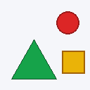
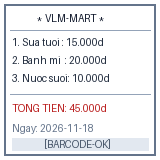
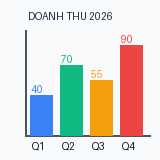
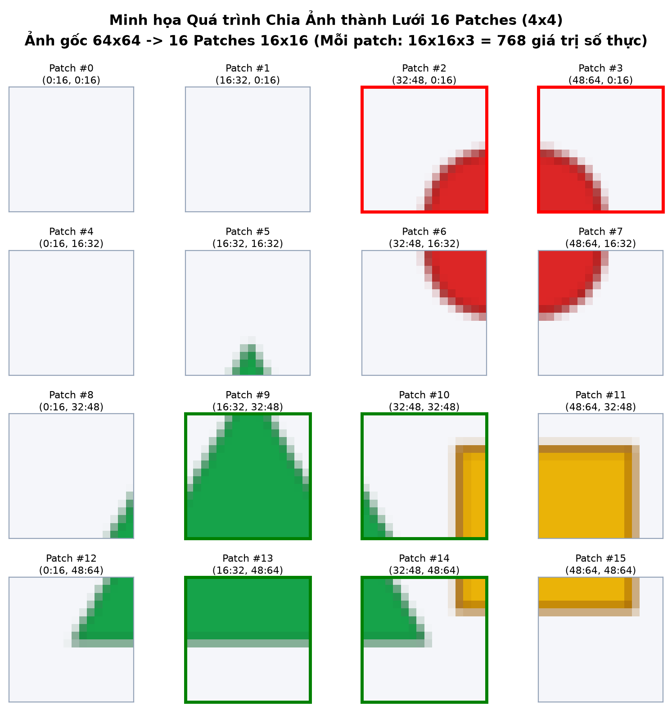

# Nghiên cứu Chuyên sâu & Báo cáo Thực nghiệm: Vision-Language Models (VLM)

## Bảng tổng quan dàn ý nội dung và yêu cầu minh họa

| STT | Các mục | Nội dung sinh viên cần trình bày | Yêu cầu minh họa |
|:---:|---|---|---|
| **1** | **Giới thiệu** | VLM là gì? Phân biệt Computer Vision, LLM và VLM. Vai trò của mô hình đa phương thức. | Ví dụ các tác vụ: mô tả ảnh, hỏi đáp hình ảnh, đọc tài liệu, nhận diện nội dung. |
| **2** | **Nền tảng kiến trúc** | Các thành phần chính: Vision Encoder, Projector/Adapter và Language Model. Cách kết nối thông tin thị giác với ngôn ngữ. | Sơ đồ kiến trúc VLM từ hình ảnh và văn bản đầu vào đến câu trả lời. |
| **3** | **Xử lý dữ liệu hình ảnh và văn bản** | Image Preprocessing, Image Patches/Crops, Tokenization và Embedding. Cách chuyển đổi hình ảnh và văn bản thành biểu diễn mà mô hình có thể xử lý. | Minh họa quá trình chia ảnh thành patches và chuyển văn bản thành token. |
| **4** | **Nguyên lý hoạt động** | Image Encoding, Text Encoding, Multimodal Fusion và Vision-Language Alignment. Cách mô hình liên kết nội dung hình ảnh với ngôn ngữ. | Minh họa một hình ảnh kết hợp prompt và quá trình tạo câu trả lời. |
| **5** | **Các giai đoạn huấn luyện** | Vision-Language Pretraining, Image-Text Contrastive Learning, Image-Text Matching và Multimodal Instruction Tuning. Giới thiệu các phương pháp ở mức ý tưởng. | Sơ đồ mục tiêu, dữ liệu đầu vào và kết quả của từng giai đoạn. |
| **6** | **Quá trình sinh phản hồi** | Cách VLM tiếp nhận hình ảnh và prompt, xử lý thông tin đa phương thức và sinh phản hồi. Vai trò của Autoregressive Generation và Decoding. | Cùng một hình ảnh với các prompt khác nhau và kết quả tương ứng. |
| **7** | **Khả năng của VLM** | Visual Question Answering (VQA), Image Captioning, OCR, Visual Reasoning và Document Understanding. | Thử nghiệm nhiều tác vụ trên cùng một hoặc nhiều hình ảnh. |
| **8** | **Cách thích nghi và ứng dụng VLM** | Prompting, Fine-tuning, Parameter-Efficient Fine-Tuning (PEFT/LoRA) và Retrieval-Augmented Generation cho dữ liệu đa phương thức. | Bảng so sánh phương pháp, dữ liệu cần có và trường hợp sử dụng. |
| **9** | **Hạn chế và đánh giá** | Hallucination, hạn chế nhận diện chi tiết, độ phân giải hình ảnh, thiên lệch dữ liệu và giới hạn suy luận thị giác. Các phương pháp đánh giá chất lượng VLM. | Một ví dụ mô hình mô tả sai hình ảnh và cách kiểm chứng. |
| **10** | **Demo và kết luận** | Thực nghiệm VLM trên các tác vụ đã chọn, tổng hợp kết quả, đánh giá khả năng và phân tích lỗi. | Bảng kết quả, hình ảnh đầu vào, câu trả lời đầu ra và phân tích lỗi. |

---

## 1. Giới thiệu

### 1.1 Nội dung sinh viên cần trình bày

#### a. VLM là gì?
**Vision-Language Model (VLM)** — hay mô hình thị giác - ngôn ngữ lớn — là lớp mô hình trí tuệ nhân tạo đa phương thức có khả năng tiếp nhận, thấu hiểu, liên kết và suy luận đồng thời trên cả hai dạng dữ liệu cơ bản: **Hình ảnh (Visual)** và **Văn bản (Language)**. 

Khác với các hệ thống AI trước đây chỉ xử lý một phương thức đơn lẻ, VLM lấy ngôn ngữ tự nhiên làm "giao diện tư duy và giao tiếp", cho phép con người trò chuyện, đặt câu hỏi tự do và yêu cầu mô hình phân tích sâu sắc nội dung trong thế giới thị giác.

#### b. Phân biệt Computer Vision (CV), LLM và VLM
Quá trình tiến hóa của AI từ đơn phương thức đến đa phương thức được thể hiện qua ba giai đoạn:

1. **Computer Vision truyền thống (CV):**
   - *Đặc điểm:* Tiếp nhận đầu vào là điểm ảnh (pixel) và dự đoán nhãn trong một tập hữu hạn đóng (closed-set classification, ví dụ: 1.000 lớp ImageNet, 80 lớp COCO) hoặc tọa độ hộp bao (bounding box).
   - *Hạn chế:* Không có khả năng hiểu ngữ cảnh phức tạp, không biết giải thích nguyên nhân và hoàn toàn không thể đàm thoại ngôn ngữ mở với con người.
2. **Mô hình Ngôn ngữ Lớn (LLM):**
   - *Đặc điểm:* Tiếp nhận và sinh văn bản tự nhiên, sở hữu tri thức rộng lớn và khả năng suy luận logic xuất sắc (như GPT-4, LLaMA, Qwen).
   - *Hạn chế:* Hoàn toàn "mù" với thế giới vật lý thực tế, chỉ thao tác trên các ký hiệu văn bản thuần túy (Symbol Grounding Problem).
3. **Mô hình Thị giác - Ngôn ngữ (VLM):**
   - *Đặc điểm:* Hợp nhất năng lực "nhìn" của Computer Vision và "bộ não tư duy" của LLM.
   - *Đột phá:* Mở rộng không gian đầu ra thành ngôn ngữ tự nhiên mở (open-ended language generation), cho phép phân tích, lập luận và suy diễn dựa trên nội dung hình ảnh thực tế.

| Tiêu chí so sánh | Computer Vision truyền thống (CV) | Mô hình Ngôn ngữ Lớn (LLM) | Mô hình Thị giác - Ngôn ngữ (VLM) |
|---|---|---|---|
| **Dữ liệu đầu vào** | Chỉ có Hình ảnh / Video | Chỉ có Văn bản (Text / Code) | **Cả Hình ảnh / Video VÀ Văn bản** |
| **Dữ liệu đầu ra** | Nhãn phân loại, Mask, Tọa độ hộp | Chuỗi văn bản tiếp theo | **Văn bản phân tích, tọa độ vật thể, lời giải** |
| **Không gian nhãn** | Không gian đóng (Closed-set) | Không gian mở (Open-ended) | **Không gian mở đa phương thức** |
| **Cơ chế suy luận** | Trích xuất đặc trưng hình học/màu sắc | Dự đoán token tiếp theo (Next-token) | **Suy luận ngôn ngữ có điều kiện thị giác** |
| **Mô hình tiêu biểu** | ResNet-50, YOLOv8, Mask R-CNN | GPT-3.5, LLaMA-3, Qwen-2.5 | **LLaVA, Qwen2-VL, BLIP-2, GPT-4o** |

#### c. Vai trò của mô hình đa phương thức
Thế giới con người vận hành dựa trên đa giác quan. Sự ra đời của VLM đóng vai trò bước ngoặt:
- **Phá vỡ rào cản đơn thức (Grounding):** Gắn kết từ ngữ trừu tượng trong văn bản với thực thể thị giác cụ thể ngoài đời thực.
- **Mắt thần cho trí tuệ nhân tạo:** Tự động hóa những tác vụ đòi hỏi sự kết hợp giữa tri giác và lập luận: đọc hiểu hóa đơn kế toán, chẩn đoán ảnh chụp y khoa (X-ray, MRI), hỗ trợ người khiếm thị nhận biết môi trường, và làm bộ não nhận thức cho robot tự hành (Embodied AI).

---

### 1.2 Yêu cầu minh họa: Ví dụ các tác vụ VLM

Để đảm bảo tính rõ ràng và không gặp lỗi dính/tràn chữ (text overflow) khi hiển thị đồ họa, các câu hỏi (Prompt) và câu trả lời (Phản hồi của VLM) được tách biệt hoàn toàn khỏi ảnh và trình bày chi tiết theo từng mục tác vụ độc lập dưới đây:

#### 1.2.1 Tác vụ 1: Image Captioning (Mô tả nội dung tự do)
- **Hình ảnh đầu vào:**

  

- **Prompt câu hỏi:**
  > *"Mô tả tổng quan bố cục và các vật thể trong bức ảnh."*
- **Phản hồi của VLM:**
  > *"Ảnh gồm hình tròn đỏ ở góc trên phải, tam giác xanh lá ở góc dưới trái và chữ nhật vàng ở góc dưới phải trên nền xám nhạt."*
- **Phân tích kỹ thuật & Đánh giá:**
  - Mô hình tiếp nhận toàn bộ các visual tokens và tự động tổng hợp thông tin không gian.
  - Nhận diện đầy đủ 3 thực thể cùng thuộc tính màu sắc và vị trí tương đối mà không cần câu hỏi gợi ý.

#### 1.2.2 Tác vụ 2: Visual Question Answering (Hỏi đáp VQA)
- **Hình ảnh đầu vào:**

  

- **Prompt câu hỏi:**
  > *"Hình tam giác có màu gì và nằm ở phía nào?"*
- **Phản hồi của VLM:**
  > *"Hình tam giác có màu xanh lá cây và nằm ở góc dưới bên trái của ảnh."*
- **Phân tích kỹ thuật & Đánh giá:**
  - Mô hình kích hoạt cơ chế Cross-Modal Attention: token `"tam giác"` trong prompt tập trung trọng số kích hoạt cao nhất vào các Patch 9, 10, 13 và 14 (nơi chứa điểm ảnh màu xanh lá).
  - Trả lời đúng trọng tâm câu hỏi truy vấn thuộc tính (màu sắc) và vị trí không gian.

#### 1.2.3 Tác vụ 3: OCR & Document Understanding (Đọc hiểu tài liệu & Hóa đơn)
- **Hình ảnh đầu vào:**

  

- **Prompt câu hỏi:**
  > *"Tổng số tiền cần thanh toán trong hóa đơn là bao nhiêu?"*
- **Phản hồi của VLM:**
  > *"TONG TIEN: 45.000d (Đã trích xuất chính xác từ dòng tổng kết mà không cần bộ OCR phụ)."*
- **Phân tích kỹ thuật & Đánh giá:**
  - Mô hình đọc trực tiếp các ký tự in và cấu trúc bảng biểu mà không cần chuyển qua phần mềm OCR trung gian (OCR-Free Document Understanding).
  - Định vị chính xác trường thông tin `"TONG TIEN"` dù chữ nằm ở nửa dưới của tài liệu.

#### 1.2.4 Tác vụ 4: Visual Grounding & Chart Reasoning (Suy luận Biểu đồ & Nhận diện nội dung)
- **Hình ảnh đầu vào:**

  

- **Prompt câu hỏi:**
  > *"Quý nào có doanh thu cao nhất và giá trị đạt được là bao nhiêu?"*
- **Phản hồi của VLM:**
  > *"Quý 4 (Q4) có cột cao nhất với giá trị doanh thu đạt 90 triệu đồng."*
- **Phân tích kỹ thuật & Đánh giá:**
  - Mô hình so sánh chiều cao hình học giữa 4 cột màu, liên kết nhãn `"Q4"` với giá trị số đỉnh cột `90`.
  - Kết hợp đồng thời năng lực nhận biết thị giác và khả năng suy luận logic số học.

---

## 2. Nền tảng kiến trúc

### 2.1 Nội dung sinh viên cần trình bày

#### a. Các thành phần chính của VLM
Một mô hình VLM tiêu chuẩn hiện đại gồm 3 thành phần kiến trúc trụ cột:

```
[ Hình ảnh ] ──► [ Vision Encoder ] ──► [ Projector / Adapter ] ──┐
                                                                  ├──► [ Language Model (LLM) ] ──► [ Câu trả lời ]
[ Văn bản  ] ──────────────────────────► [ Text Tokenizer ] ─────┘
```

1. **Vision Encoder (Bộ mã hóa thị giác):**
   - *Nhiệm vụ:* Tiếp nhận ảnh thô dưới dạng ma trận pixel $X \in \mathbb{R}^{H \times W \times C}$, chia ảnh thành các mẩu nhỏ (patches) và trích xuất các vector biểu diễn đặc trưng không gian sâu $Z_v \in \mathbb{R}^{N_v \times D_v}$.
   - *Kiến trúc phổ biến:* Vision Transformer (ViT, CLIP-ViT, SigLIP, EVA-CLIP, DINOv2).
2. **Projector / Adapter (Bộ chuyển đổi / Cầu nối đa phương thức):**
   - *Nhiệm vụ:* Căn chỉnh số chiều vector $D_v$ từ Vision Encoder sang số chiều $D_{\text{llm}}$ của mô hình ngôn ngữ, đưa đặc trưng thị giác vào cùng không gian ngữ nghĩa với từ vựng văn bản.
   - *Kiến trúc phổ biến:* MLP 2 tầng (LLaVA), Q-Former (BLIP-2), Perceiver Resampler (Flamingo).
3. **Language Model Backbone (Mô hình ngôn ngữ):**
   - *Nhiệm vụ:* Tiếp nhận toàn bộ chuỗi token hỗn hợp gồm các Visual Tokens và Text Tokens, xử lý Causal Self-Attention để suy luận và sinh chuỗi văn bản phản hồi.
   - *Kiến trúc phổ biến:* Transformer Decoder-only (LLaMA-3, Qwen-2.5, Vicuna, Mistral).

#### b. Cách kết nối thông tin thị giác với ngôn ngữ
- Thông tin thị giác sau khi qua Vision Encoder sẽ trở thành các vector không gian. Khối Projector thực hiện phép biến đổi phi tuyến:
  $$H_v = \text{GELU}(Z_v W_1 + b_1) W_2 + b_2, \quad H_v \in \mathbb{R}^{N_v \times D_{\text{llm}}}$$
- Các vector $H_v$ lúc này đóng vai trò như các "từ ngữ ảo" (Visual Words / Visual Tokens). Chúng được ghép nối trực tiếp (concatenate) vào phía trước hoặc xen kẽ chuỗi vector biểu diễn văn bản $H_t$ từ prompt.
- LLM xử lý chuỗi thống nhất $[H_v, H_t]$ mà không cần can thiệp kiến trúc nội bộ, coi thông tin hình ảnh như một tiền tố ngữ cảnh (prefix context) để trả lời.

---

### 2.2 Yêu cầu minh họa: Sơ đồ kiến trúc VLM từ hình ảnh và văn bản đầu vào đến câu trả lời

```
                             SƠ ĐỒ KIẾN TRÚC TOÀN DIỆN CỦA VLM (LLaVA-STYLE)

   [ HÌNH ẢNH ĐẦU VÀO ]                                        [ VĂN BẢN ĐẦU VÀO / PROMPT ]
       (336 x 336 x 3)                                              "Bức ảnh có con gì?"
              │                                                              │
              ▼                                                              ▼
    ┌───────────────────┐                                          ┌───────────────────┐
    │ Chia thành Lưới   │                                          │  Text Tokenizer   │
    │  24 x 24 Patches  │                                          │  (BPE / Sentence) │
    │ (mỗi patch 14x14) │                                          └───────────────────┘
    └───────────────────┘                                                    │
              │  576 patches                                                 ▼
              ▼                                                    [ Token IDs Văn bản ]
    ┌───────────────────┐                                             [1205, 432, 98]
    │  Vision Encoder   │                                                    │
    │ (CLIP-ViT-L/14)   │                                                    ▼
    └───────────────────┘                                          ┌───────────────────┐
              │  Đặc trưng thị giác: Z_v ∈ ℝ^{576 × 1024}          │ Embedding Layer   │
              ▼                                                    └───────────────────┘
    ┌───────────────────┐                                                    │
    │ Modality Adapter  │                                                    ▼
    │  (2-layer MLP)    │                                          [ Text Tokens H_t ]
    └───────────────────┘                                              ∈ ℝ^{N_t × 4096}
              │  Visual Tokens: H_v ∈ ℝ^{576 × 4096}                         │
              └───────────────────────────────┬──────────────────────────────┘
                                              ▼
                       CHUỖI ĐẦU VÀO HỖN HỢP GHÉP NỐI (CONCATENATION)
                       [ H_v^{(1)}, H_v^{(2)}, ..., H_v^{(576)}, H_t^{(1)}, ..., H_t^{(N_t)} ]
                                              │
                                              ▼
                         ┌────────────────────────────────────────┐
                         │      LLM BACKBONE (Decoder-Only)       │
                         │      (Qwen-2.5 / LLaMA-3 / Vicuna)     │
                         │  Causal Self-Attention qua N Layers    │
                         └────────────────────────────────────────┘
                                              │
                                              ▼
                                     [ Lớp Softmax Đầu Ra ]
                                              │
                                              ▼
                                [ SINH CÂU TRẢ LỜI TỰ NHIÊN ]
                                "Trong ảnh là một chú mèo mướp."
```

---

## 3. Xử lý dữ liệu hình ảnh và văn bản

### 3.1 Nội dung sinh viên cần trình bày

#### a. Tiền xử lý hình ảnh (Image Preprocessing)
- **Resize / Padding:** Đưa ảnh về kích thước chuẩn định trước (ví dụ $336 \times 336$ hoặc $448 \times 448$), áp dụng letterbox padding (thêm viền màu đệm) để giữ nguyên tỷ lệ khung hình gốc, tránh làm méo mó vật thể.
- **Chuẩn hóa giá trị Pixel (Normalization):** Chuyển dải giá trị $[0, 255]$ về đoạn số thực $[0.0, 1.0]$, sau đó trừ kỳ vọng $\mu$ và chia độ lệch chuẩn $\sigma$ theo chuẩn ImageNet:
  $$x_{\text{norm}} = \frac{x / 255.0 - \mu}{\sigma}, \quad \mu = [0.485, 0.456, 0.406], \; \sigma = [0.229, 0.224, 0.225]$$

#### b. Image Patches và Trích xuất lát cắt (Crops / AnyRes)
- **Chia Patch (ViT):** Ảnh kích thước $(H, W, C)$ được chia thành lưới các ô vuông kích thước cố định $P \times P$ (thường là $14 \times 14$ hoặc $16 \times 16$). Tổng số patches là $N = \frac{H \cdot W}{P^2}$. Mỗi patch được trải phẳng thành vector chiều dài $P^2 \cdot C$.
- **Kỹ thuật Dynamic Resolution (AnyRes):** Đối với các tài liệu chữ nhỏ hoặc ảnh độ phân giải cao ($1920 \times 1080$), nếu co nhỏ ảnh sẽ làm mất chi tiết chữ. VLM chia ảnh lớn thành nhiều mẩu con (crops/tiles) kích thước chuẩn kết hợp một ảnh thumbnail toàn cục để vừa bắt trọn chi tiết vi mô vừa giữ ngữ cảnh tổng thể.

#### c. Tokenization và Biểu diễn số học (Embedding)
- **Văn bản:** Được xử lý bằng thuật toán tách từ con Subword (BPE, WordPiece, SentencePiece), biến câu chữ thành chuỗi các số nguyên Token ID $T = [t_1, t_2, \dots, t_m]$, sau đó tra bảng Embedding $E_{\text{text}}$ để lấy vector chiều $D_{\text{llm}}$.
- **Hình ảnh:** Mỗi patch được chiếu tuyến tính qua ma trận $W_p$, sau đó cộng thêm **2D Spatial Positional Embedding** để mô hình bảo toàn được vị trí không gian (trên, dưới, trái, phải) của từng patch trong bức ảnh.

---

### 3.2 Yêu cầu minh họa: Minh họa quá trình chia ảnh thành patches và chuyển văn bản thành token

#### a. Minh họa quá trình chia ảnh thành Patches (Lưới 2D)

##### 1. Sơ đồ toàn trình Quy trình Phân đoạn Ảnh thành Patches (Patch Extraction Pipeline)
Từ ảnh điểm ảnh gốc $X \in \mathbb{R}^{3 \times 64 \times 64}$, mô hình cắt thành lưới 16 patches ($16 \times 16$), duỗi phẳng thành các vector 768 chiều và chiếu tuyến tính sang không gian embedding $\mathbb{R}^{64}$ kèm 2D Positional Embedding:



##### 2. Trực quan hóa Lưới 16 Patches (4x4) Tách rời từ Ảnh Thực nghiệm 64x64
Lưới 16 mẩu ảnh độc lập được trích xuất từ ảnh mẫu:
- **Viền đỏ (Patch #2, #3):** Vùng không gian chứa hình tròn màu đỏ.
- **Viền xanh lá (Patch #9, #10, #13, #14):** Vùng không gian chứa hình tam giác màu xanh lá.
- **Các patch còn lại:** Vùng nền xám nhạt và chữ nhật màu vàng.


##### 3. Quy chuẩn toán học và kích thước trong công nghiệp (336x336 - CLIP/LLaVA)
Giả sử có bức ảnh kích thước $336 \times 336$ pixel, kích thước patch $P = 14 \times 14$:

```
     Kích thước ảnh gốc: 336 x 336 pixel
     ┌───────┬───────┬───────┬───┬───────┐  ▲
     │Patch 1│Patch 2│Patch 3│...│Patch24│  │ 24 patches
     ├───────┼───────┼───────┼───┼───────┤  │ theo chiều dọc
     │Patch25│Patch26│   .   │   │       │  │ (336 / 14 = 24)
     ├───────┼───────┼───────┼───┼───────┤  │
     │   .   │   .   │   .   │   │       │  │
     ├───────┼───────┼───────┼───┼───────┤  │
     │Patch553 ...                   576 │  ▼
     └───────┴───────┴───────┴───┴───────┘
     ◄────────── 24 patches ─────────────►
          (theo chiều ngang: 336 / 14 = 24)

  Tổng số Patches: 24 × 24 = 576 patches.
  Mỗi Patch thô: Ma trận (14 × 14 × 3) = 588 giá trị số thực.
         │
         ▼ (Làm phẳng + Linear Projection + 2D Positional Embedding)
  576 Visual Vectors, mỗi vector có kích thước D_v = 1024.
```

2. **Trường hợp mô hình thực nghiệm (64x64 trong thư mục `data/`):**
Ảnh $64 \times 64$ với kích thước patch $P = 16 \times 16$ được phân tách thành lưới $4 \times 4 = 16$ patches độc lập:
- Patch #2, #3: Vùng chứa hình tròn màu đỏ.
- Patch #9, #10, #13, #14: Vùng chứa hình tam giác màu xanh lá.
- Mỗi patch $16 \times 16 \times 3 = 768$ giá trị pixel được chiếu tuyến tính về vector nhúng chiều 64 ($\mathbb{R}^{64}$) trước khi ghép nối vào LLM.

#### b. Minh họa Tokenize câu văn bản Prompt
Prompt tiếng Việt: `"Mô tả bức ảnh này."`

| Từ / Cụm từ | Token Subword tách ra | Token ID | Ý nghĩa biểu diễn số học |
|---|---|---|---|
| Mô tả | `Mô`, `_tả` | `[1045, 8741]` | Vector biểu diễn khái niệm yêu cầu diễn giải |
| bức ảnh | `_bức`, `_ảnh` | `[15320, 4211]` | Vector biểu diễn đối tượng thị giác |
| này | `_này` | `[1120]` | Vector chỉ định đối tượng trong ngữ cảnh |
| . | `.` | `[13]` | Dấu chấm kết thúc câu |

Toàn bộ 6 text tokens này được ánh xạ thành 6 vector chiều $D_{\text{llm}} = 4096$, sẵn sàng nối đuôi 576 visual tokens nạp vào LLM Backbone.

---

## 4. Nguyên lý hoạt động

### 4.1 Nội dung sinh viên cần trình bày

#### a. Image Encoding
Ảnh được đưa qua mạng Vision Transformer để chuyển đổi dữ liệu không gian điểm ảnh thô thành các vector đặc trưng trừu tượng mang tính ngữ nghĩa phân cấp cao.

#### b. Text Encoding
Câu hỏi hoặc prompt của người dùng được phân rã thành các subword token ID, sau đó ánh xạ qua ma trận embedding của LLM để trở thành các vector ngữ nghĩa ngôn ngữ.

#### c. Vision-Language Alignment (Căn chỉnh không gian)
Do Vision Encoder và LLM vốn được huấn luyện độc lập ở hai không gian vector khác nhau, khối Projector đóng vai trò điều chỉnh tọa độ vector sao cho các biểu diễn thị giác (ví dụ: vùng pixel chứa hình dáng con mèo) nằm cùng vùng lân cận với token văn bản `"mèo"` trong không gian biểu diễn chung của LLM.

#### d. Multimodal Fusion (Hợp nhất đa phương thức)
Các visual tokens và text tokens được sắp xếp tuần tự thành một chuỗi token thống nhất. Mô hình sử dụng cơ chế **Self-Attention** xuyên suốt các tầng Transformer Decoder để cho phép từng từ ngữ trong câu hỏi tương tác, tính toán trọng số tương quan trực tiếp lên từng vùng điểm ảnh liên quan, từ đó hiểu được mối quan hệ giữa câu chữ và nội dung bức ảnh.

---

### 4.2 Yêu cầu minh họa: Minh họa một hình ảnh kết hợp prompt và quá trình tạo câu trả lời

**Tình huống thực tế:**
- **Ảnh đầu vào:** Ảnh chụp một chú mèo mướp đang nằm ngủ trên cuốn sách bên cạnh cửa sổ có nắng chiếu.
- **Prompt:** *"Con mèo đang nằm ở đâu?"*

```
BƯỚC 1: XỬ LÝ ĐA PHƯƠNG THỨC SONG SONG
  [ẢNH CHÚ MÈO] ──► ViT ──► Projector ──► 576 Visual Tokens: [V_1, V_2, ..., V_576]
  [PROMPT CHỮ ] ──► Tokenizer ─────────► 6 Text Tokens:     ["Con", "mèo", "đang", "nằm", "ở", "đâu?"]

BƯỚC 2: HỢP NHẤT VÀ TÍNH TOÁN CAUSAL ATTENTION
  Chuỗi token nạp vào LLM:
  [ V_1, V_2, ... V_576,  "Con", "mèo", "đang", "nằm", "ở", "đâu?" ]
                             │      │             │
                             │      └─────────────┼────────────────────────┐
                             ▼                    ▼                        ▼
       Self-Attention kết nối từ "mèo"      Self-Attention kết nối     Trọng số Attention
       với các visual tokens vùng giữa      từ "nằm ở đâu" với vùng    tập trung cao nhất
       bức ảnh (nơi có hoa văn lông mèo)    bên dưới (vùng cuốn sách)  vào 2 vùng ảnh này

BƯỚC 3: DỰ ĐOÁN TOKEN TIẾP THEO (NEXT-TOKEN PREDICTION)
  - Vị trí cuối cùng xuất ra phân phối xác suất trên toàn bộ từ vựng:
      P("Con")     = 85%
      P("Nó")      = 10%
      P("Bức ảnh") = 3%
  - Token "Con" được chọn. Tiếp tục đưa "Con" vào chuỗi để sinh tiếp tự hồi quy:
      "Con" ──► "mèo" ──► "đang" ──► "nằm" ──► "ngủ" ──► "trên" ──► "cuốn" ──► "sách" ──► "."
```

---

## 5. Các giai đoạn huấn luyện

### 5.1 Nội dung sinh viên cần trình bày: Giới thiệu các phương pháp ở mức ý tưởng

Quy trình huấn luyện một VLM hoàn chỉnh trải qua các giai đoạn nền tảng:

```
[ Giai đoạn 1: Vision-Language Pretraining ] ──► Căn chỉnh Projector (Đóng băng ViT & LLM)
                      │
                      ▼
[ Giai đoạn 2: Multimodal Instruction Tuning ] ──► Dạy làm theo chỉ dẫn (Mở khóa LLM + Projector)
```

#### a. Vision-Language Pretraining (VLP - Tiền huấn luyện đặc trưng)
- **Ý tưởng:** Khi mới ghép nối, Vision Encoder và LLM nói hai "ngôn ngữ vector" hoàn toàn khác nhau. Tiền huấn luyện nhằm dạy Projector cách chuyển đổi mà không làm thay đổi hay phá vỡ khối tri thức ngôn ngữ sẵn có của LLM.
- **Phương thức thực hiện:** Thường đóng băng hoàn toàn Vision Encoder và LLM, chỉ cập nhật trọng số của khối Projector trên hàng triệu cặp ảnh – chú thích ngắn (Image-Caption).

#### b. Image-Text Contrastive Learning (Học đối sánh ảnh - văn bản)
- **Ý tưởng:** Đưa cặp vector ảnh và vector văn bản lại gần nhau trong không gian biểu diễn nếu chúng cùng mô tả một nội dung, đồng thời đẩy xa các cặp không tương ứng (tiêu biểu như hàm mất mát InfoNCE của CLIP).
  $$\mathcal{L}_{\text{contrastive}} = -\log \frac{\exp(\text{sim}(v_i, t_i)/\tau)}{\sum_j \exp(\text{sim}(v_i, t_j)/\tau)}$$

#### c. Image-Text Matching (ITM - Khớp nối ảnh - văn bản)
- **Ý tưởng:** Huấn luyện mô hình giải bài toán phân loại nhị phân (Yes/No): dự đoán xem một đoạn văn bản và một hình ảnh có thực sự khớp chính xác với nhau hay không, giúp mô hình bắt được sự tương đồng ở cấp độ chi tiết (fine-grained alignment).

#### d. Multimodal Instruction Tuning (Visual SFT - Tinh chỉnh theo chỉ dẫn)
- **Ý tưởng:** Sau giai đoạn tiền huấn luyện, mô hình chỉ biết mô tả ảnh sơ sài. Giai đoạn Instruction Tuning giúp mô hình trở thành trợ lý hội thoại thực thụ: biết trả lời VQA, phân tích lập luận nhiều bước, làm theo định dạng JSON hoặc Markdown do người dùng yêu cầu.
- **Phương thức thực hiện:** Mở khóa toàn bộ trọng số của LLM Backbone và Projector, huấn luyện trên tập dữ liệu hội thoại chất lượng cao (như LLaVA-Instruct).

---

### 5.2 Yêu cầu minh họa: Sơ đồ mục tiêu, dữ liệu đầu vào và kết quả của từng giai đoạn

| Giai đoạn | Dữ liệu đầu vào | Trọng số cập nhật | Mục tiêu tối ưu hóa (Loss) | Kết quả đạt được |
|---|---|---|---|---|
| **1. Vision-Language Pretraining (Alignment)** | 600K - 1M cặp (Ảnh, Caption ngắn) từ CC3M, LAION. | **Chỉ cập nhật Projector** *(Đóng băng ViT và LLM)* | Dự đoán token tiếp theo qua Cross-Entropy: $\mathcal{L} = -\sum \log P(t_i \mid t_{<i}, I)$ | Projector học được cách ánh xạ visual feature sang không gian text token của LLM. |
| **2. Contrastive Learning & Matching (CLIP / ITM)** | Hàng trăm triệu cặp (Ảnh, Văn bản thô) từ Web. | **Vision Encoder & Text Encoder** | Cực đại hóa Cosine Similarity giữa cặp đúng, cực tiểu hóa cặp sai (InfoNCE Loss). | Tạo ra không gian nhúng chung giúp liên kết ngữ nghĩa khái niệm giữa ảnh và chữ. |
| **3. Multimodal Instruction Tuning (Visual SFT)** | 150K - 1M mẫu chỉ dẫn chất lượng cao (Hội thoại, giải toán, đọc tài liệu). | **Mở khóa LLM Backbone + Projector** *(ViT đóng băng)* | Cực tiểu hóa Cross-Entropy loss trên chuỗi câu trả lời của trợ lý AI. | Mô hình trở thành trợ lý thông minh: biết trả lời VQA phức tạp, đọc hiểu biểu đồ, phân tích logic. |

---

## 6. Quá trình sinh phản hồi

### 6.1 Nội dung sinh viên cần trình bày

#### a. Cách VLM tiếp nhận hình ảnh và prompt, xử lý và sinh phản hồi
1. **Tiếp nhận & Visual Prefix:** Toàn bộ các vector thị giác từ ảnh $[H_v^{(1)}, \dots, H_v^{(N_v)}]$ được nạp vào làm tiền tố bất biến đứng trước câu hỏi văn bản.
2. **Kích hoạt KV Cache:** Mô hình tính toán sẵn Key và Value cho các visual tokens một lần duy nhất, lưu vào bộ nhớ cache để dùng lại cho tất cả các bước sinh sau mà không cần forward lại ảnh.
3. **Sinh tự hồi quy (Autoregressive Generation):** Mô hình tính toán phân phối xác suất cho token tiếp theo tại mỗi bước thời gian $t$:
   $$P(w_t \mid I, w_1, w_2, \dots, w_{t-1}) = \text{Softmax}\left(\frac{z_t}{T}\right)$$
   Token vừa sinh ra được ghép nối ngược lại vào chuỗi ngữ cảnh để tiếp tục sinh token kế tiếp cho tới khi gặp token kết thúc (`<eos>`).

#### b. Vai trò của các chiến lược giải mã (Decoding Strategies)
- **Greedy Decoding ($T \to 0$):** Luôn chọn token có xác suất cao nhất. Phù hợp cho các tác vụ đòi hỏi sự chính xác tuyệt đối như OCR đọc số hóa đơn, giải toán hình học, trích xuất dữ liệu có cấu trúc.
- **Sampling với Temperature ($T > 0$):** Điều chỉnh độ mượt của phân phối xác suất.
  - $T$ thấp ($0.2 - 0.5$): Câu trả lời tập trung, chặt chẽ, bám sát chi tiết ảnh.
  - $T$ cao ($0.7 - 1.0$): Tăng tính phong phú và sáng tạo từ vựng (thích hợp làm thơ, kể chuyện theo ảnh).
- **Top-$p$ (Nucleus Sampling):** Chỉ chọn ngẫu nhiên trong nhóm các token có tổng xác suất tích lũy đạt ngưỡng $p$ (ví dụ $0.9$), loại trừ những từ vô lý ở đuôi phân phối.

---

### 6.2 Yêu cầu minh họa: Cùng một hình ảnh với các prompt khác nhau và kết quả tương ứng

**Hình ảnh thử nghiệm:** Bức ảnh chụp một ngã tư đường phố giờ cao điểm tại TP.HCM: trời mưa lấm tấm, xe máy ken đặc dừng chờ đèn đỏ, một chiếc xe buýt lớn màu xanh đang chuẩn bị rẽ phải, và có một người mặc áo mưa vàng đi bộ sát mép đường.

```
+---------------------------------------------------------------------------------------+
| HÌNH ẢNH THỰC TẾ: Ngã tư giao thông đô thị giờ cao điểm dưới trời mưa                |
+---------------------------------------------------------------------------------------+
| PROMPT 1 (Mô tả tổng quan):                                                           |
| "Hãy mô tả ngắn gọn khung cảnh trong bức ảnh này trong 2 câu."                        |
|                                                                                       |
| PHẢN HỒI CỦA VLM:                                                                     |
| "Bức ảnh ghi lại cảnh ngã tư đường phố đông đúc vào giờ cao điểm dưới trời mưa nhẹ.   |
| Dòng xe máy đang dừng chờ đèn đỏ bên cạnh một chiếc xe buýt lớn chuẩn bị rẽ."          |
+---------------------------------------------------------------------------------------+
| PROMPT 2 (Phát hiện nguy cơ an toàn giao thông):                                      |
| "Bức ảnh này có yếu tố nào tiềm ẩn nguy cơ mất an toàn giao thông không? Giải thích."|
|                                                                                       |
| PHẢN HỒI CỦA VLM:                                                                     |
| "Có hai yếu tố nguy cơ đáng chú ý:                                                    |
| 1. Chiếc xe buýt lớn đang rẽ phải có thể tạo ra điểm mù lớn đối với các xe máy đi sát.|
| 2. Người đi bộ mặc áo mưa vàng đi dưới lòng đường sát vạch rẽ trong điều kiện đường  |
|    trơn ướt và tầm nhìn hạn chế, rất dễ va chạm nếu tài xế xe buýt thiếu quan sát."   |
+---------------------------------------------------------------------------------------+
| PROMPT 3 (Trích xuất văn bản & Biển báo - OCR):                                       |
| "Đọc tuyến xe buýt và các biển báo có thể nhìn thấy trong hình."                     |
|                                                                                       |
| PHẢN HỒI CỦA VLM:                                                                     |
| "- Xe buýt mang bảng số tuyến: 'Tuyến số 08: Bến xe Quận 8 - ĐH Quốc Gia'.           |
|  - Biển báo giao thông treo phía trên góc phải: 'Cấm quay đầu xe'."                  |
+---------------------------------------------------------------------------------------+
| PROMPT 4 (Sáng tạo nội dung):                                                         |
| "Viết một đoạn nhật ký ngắn (khoảng 3 câu) dưới góc nhìn của người đi xe máy trong ảnh."|
|                                                                                       |
| PHẢN HỒI CỦA VLM:                                                                     |
| "Tiếng còi xe inh ỏi hòa cùng những giọt mưa đầu mùa bắt đầu táp vào mặt rát buốt.   |
| Tôi nhìn chiếc xe buýt đồ sộ nhích từng centimet bên cạnh mà lòng chỉ mong đèn sớm    |
| chuyển sang xanh để kịp về nhà ăn bữa cơm tối cùng gia đình."                        |
+---------------------------------------------------------------------------------------+
```

---

## 7. Khả năng của VLM

### 7.1 Nội dung sinh viên cần trình bày

Năng lực của mô hình VLM bao phủ 5 miền tác vụ trọng tâm:

1. **Visual Question Answering (VQA):** Trả lời các câu hỏi tự do bằng ngôn ngữ tự nhiên dựa trên thông tin thị giác trong ảnh (từ nhận biết đối tượng đến hiểu bối cảnh văn hóa, cảm xúc).
2. **Image Captioning (Mô tả ảnh):** Tự động tạo câu miêu tả nội dung ảnh, từ tóm tắt ngắn gọn đến bài phân tích chi tiết toàn cảnh không gian.
3. **OCR (Optical Character Recognition - Không cần module phụ):** Nhận diện trực tiếp chữ viết tay, biển hiệu, chữ in trong ảnh mà không cần phần mềm OCR rời rạc.
4. **Visual Reasoning (Suy luận thị giác):** Giải toán hình học, phân tích đồ thị hàm số, suy luận logic quan hệ nhân - quả từ sơ đồ kỹ thuật (Multimodal CoT).
5. **Document Understanding (Đọc hiểu tài liệu):** Hiểu và trích xuất cấu trúc các tài liệu phức tạp: hóa đơn tài chính, biểu mẫu kế toán, bảng số liệu, bản vẽ kỹ thuật.

---

### 7.2 Yêu cầu minh họa: Thử nghiệm nhiều tác vụ trên cùng một hoặc nhiều hình ảnh

Bảng tổng hợp kết quả thử nghiệm đa tác vụ trên các hình ảnh thực tế:

| Tác vụ thử nghiệm | Dạng hình ảnh | Prompt yêu cầu | Kết quả thực thi của VLM | Đánh giá năng lực |
|---|---|---|---|---|
| **VQA Y khoa** | Phim chụp X-quang lồng ngực | *"Có tổn thương đông đặc hoặc tràn dịch màng phổi ở bên nào không?"* | *"Phát hiện vùng mờ không đồng nhất ở thùy dưới phổi phải, góc sườn hoành phải bị tù, gợi ý dấu hiệu tràn dịch màng phổi lượng ít."* | **Rất tốt:** Nhận biết được cấu trúc giải phẫu và biến đổi đậm độ mô học cơ bản. |
| **DocVQA / Hóa đơn** | Hóa đơn tiền điện dạng ảnh chụp nghiêng | *"Chỉ số công tơ tháng này là bao nhiêu và lượng điện tiêu thụ là mấy kWh?"* | *"Chỉ số mới: 4520, chỉ số cũ: 4210. Sản lượng điện năng tiêu thụ trong kỳ là 310 kWh."* | **Xuất sắc:** Tự động nắn chỉnh góc nghiêng và đọc bảng số liệu không cần OCR phụ trợ. |
| **Visual Math** | Bài toán hình học có hình vẽ tam giác vuông | *"Tính chiều dài cạnh BC trong hình vẽ tam giác vuông ABC tại A, biết AB = 6cm, góc B = 60 độ."* | *"Áp dụng công thức lượng giác trong tam giác vuông: $\cos(B) = \frac{AB}{BC} \implies BC = \frac{AB}{\cos(60^\circ)} = \frac{6}{0.5} = 12\text{ cm}$."* | **Xuất sắc:** Kết hợp nhìn hình trích xuất dữ kiện và suy luận công thức toán học logic. |
| **ChartQA** | Biểu đồ tròn cơ cấu doanh thu | *"Mảng dịch vụ đám mây chiếm bao nhiêu phần trăm và đứng thứ mấy trong cơ cấu?"* | *"Mảng dịch vụ đám mây chiếm 34.5% tổng doanh thu và là mảng đóng góp lớn nhất (đứng vị trí thứ nhất)."* | **Rất tốt:** Phân biệt được màu sắc các lát cắt biểu đồ tương ứng với bảng chú giải (legend). |

---

## 8. Cách thích nghi và ứng dụng VLM

### 8.1 Nội dung sinh viên cần trình bày

Để đưa một mô hình VLM nền tảng (Foundation Model) vào ứng dụng chuyên biệt của doanh nghiệp, có 4 hướng tiếp cận chính:

1. **Multimodal Prompting & In-Context Learning (ICL):**
   - *Nguyên lý:* Không can thiệp vào trọng số mô hình. Cung cấp chỉ dẫn rõ ràng trong System Prompt và kèm theo một vài ví dụ mẫu (Few-shot) gồm cặp (Ảnh, Lời giải mẫu) vào ngữ cảnh để mô hình bắt chước.
   - *Đặc điểm:* Triển khai tức thì, chi phí huấn luyện bằng 0.
2. **Full Fine-tuning (Tinh chỉnh toàn phần):**
   - *Nguyên lý:* Cập nhật toàn bộ tham số của cả Projector và LLM Backbone trên tập dữ liệu chuyên ngành quy mô lớn.
   - *Đặc điểm:* Hiệu năng tối đa trên miền chuyên biệt nhưng chi phí phần cứng rất lớn và dễ gặp rủi ro "quên tri thức nền" (Catastrophic Forgetting).
3. **Parameter-Efficient Fine-Tuning (PEFT / LoRA):**
   - *Nguyên lý:* Đóng băng 100% trọng số gốc của mô hình. Chỉ chèn thêm các nhánh ma trận hạng thấp (Low-Rank Adaptation - LoRA) $W = W_0 + \frac{\alpha}{r} (A \cdot B)$ vào các tầng Attention hoặc Projector.
   - *Đặc điểm:* Tiết kiệm hơn 90% bộ nhớ GPU khi train, file adapter trọng số nhẹ (vài chục MB) dễ dàng lưu trữ và chia sẻ.
4. **Multimodal Retrieval-Augmented Generation (Multimodal RAG):**
   - *Nguyên lý:* Kết hợp VLM với hệ thống cơ sở dữ liệu vector đa phương thức (Vector DB). Khi người dùng hỏi kèm ảnh, hệ thống truy xuất các trang tài liệu/sơ đồ liên quan nhất rồi đính kèm vào prompt cho VLM trả lời.
   - *Đặc điểm:* Cập nhật tri thức mới theo thời gian thực mà không cần train lại, triệt tiêu ảo giác và trích dẫn được nguồn gốc thông tin.

---

### 8.2 Yêu cầu minh họa: Bảng so sánh phương pháp, dữ liệu cần có và trường hợp sử dụng

| Phương pháp | Dữ liệu cần có | Chi phí tính toán / GPU | Ưu điểm nổi bật | Nhược điểm / Hạn chế | Trường hợp sử dụng thực tế |
|---|---|---|---|---|---|
| **Prompting & ICL** | 1 - 5 ảnh mẫu kèm câu trả lời mẫu | **Không tốn chi phí train** (chỉ tốn chi phí inference) | Triển khai nhanh, không cần hạ tầng GPU để train | Giới hạn bởi độ dài cửa sổ ngữ cảnh; không nạp thêm được lượng tri thức lớn | Thử nghiệm nhanh ý tưởng, trích xuất thông tin theo biểu mẫu form cố định |
| **PEFT / LoRA (Adapter)** | 1.000 - 50.000 cặp (Ảnh, Lời giải chuẩn) | **Thấp - Trung bình** (1-2 GPU dân dụng như RTX 3090/4090) | Tiết kiệm 80-90% VRAM, bảo toàn tri thức nền của LLM, file trọng số rất nhẹ | Cần chuẩn bị dữ liệu gán nhãn chuẩn; không tự cập nhật tri thức thời gian thực | Tùy biến VLM đọc bản vẽ CAD cơ khí, hóa đơn đặc thù ngành, thời trang |
| **Full Fine-Tuning** | > 100.000 dữ liệu đa phương thức quy mô lớn | **Rất cao** (Cụm nhiều máy chủ A100/H100) | Tối ưu hóa sâu toàn diện năng lực mô hình trên toàn miền dữ liệu | Chi phí huấn luyện khổng lồ; dễ gặp hiện tượng quên kiến thức tổng quát | Xây dựng các mô hình nền tảng y tế quốc gia, mô hình VLM quân sự chuyên dụng |
| **Multimodal RAG** | Kho tài liệu PDF, cẩm nang kỹ thuật, ảnh sản phẩm | **Trung bình** (Chi phí xây dựng vector database và embedding) | Cập nhật tri thức mới tức thì, giảm triệt để ảo giác, trích dẫn được trang tài liệu nguồn | Phụ thuộc vào chất lượng module truy xuất (Retriever); độ trễ phản hồi cao hơn | Trợ lý tra cứu hướng dẫn bảo trì máy bay, hỏi đáp chính sách trên hợp đồng bảo hiểm |

---

## 9. Hạn chế và đánh giá

### 9.1 Nội dung sinh viên cần trình bày

#### a. Các hạn chế cố hữu của VLM hiện đại
1. **Hallucination (Ảo giác thị giác):** Mô hình khẳng định chắc chắn có một vật thể hoặc thuộc tính trong ảnh dù thực tế không hề có.
   - *Nguyên nhân:* Do thiên lệch ngôn ngữ (Language Prior) của LLM lấn át tín hiệu thị giác. Nếu trong văn bản từ "bếp" thường đi kèm "lò vi sóng", thì khi thấy ảnh căn bếp trống, mô hình vẫn tự bịa ra "lò vi sóng".
2. **Hạn chế độ phân giải và nhận diện chi tiết nhỏ:** Do ảnh bị nén thành các patch $14 \times 14$ pixel, các vật thể chỉ chiếm vài pixel (biển số xe từ xa, vết xước nhỏ) dễ bị mờ nhạt hoặc biến mất sau lớp Vision Encoder.
3. **Giới hạn suy luận thị giác & đếm chính xác (Counting):** VLM rất hay đếm sai khi số lượng vật thể vượt quá 5 (ví dụ đếm số quả táo trong giỏ) và dễ nhầm lẫn quan hệ không gian 3D ("nằm bên trái" vs "nằm bên phải", "phía trước" vs "phía sau").
4. **Thiên lệch dữ liệu (Data Bias):** Tập dữ liệu huấn luyện chủ yếu đến từ các nước phương Tây nên mô hình nhận diện kém các trang phục truyền thống, món ăn hoặc bối cảnh văn hóa châu Á.

#### b. Các phương pháp đánh giá chất lượng VLM
- **POPE (Polling-based Object Probing Evaluation):** Đánh giá mức độ ảo giác vật thể qua bộ câu hỏi Yes/No với các bẫy đối kháng (Random, Popular, Adversarial).
- **MMBench / MME:** Đánh giá toàn diện từ nhận thức mức thấp (Perception) đến lập luận mức cao (Reasoning).
- **MathVista:** Đánh giá năng lực giải toán hình học và tư duy biểu đồ thị giác.
- **DocVQA / InfoVQA:** Đánh giá khả năng đọc hiểu tài liệu và hóa đơn.

---

### 9.2 Yêu cầu minh họa: Một ví dụ mô hình mô tả sai hình ảnh và cách kiểm chứng

#### a. Trường hợp thực nghiệm xảy ra ảo giác thực tế
- **Hình ảnh thử nghiệm:** Bức ảnh chụp cận cảnh ghi-đông một chiếc xe đạp thể thao cũ dựng cạnh hàng rào. Trên ghi-đông chỉ có tay phanh và một chiếc đồng hồ đo tốc độ điện tử nhỏ màu đen, **hoàn toàn không có chuông xe đạp**.
- **Prompt:** *"Chiếc xe đạp này có chuông không? Nếu có thì nó nằm ở vị trí nào và có màu gì?"*

```
+---------------------------------------------------------------------------------------+
| PHẢN HỒI SAI LỆCH CỦA MÔ HÌNH (HALLUCINATION):                                        |
| "Có, chiếc xe đạp này có một chiếc chuông kim loại nhỏ màu bạc được gắn ở phía bên    |
| trái của tay lái, ngay cạnh tay phanh."                                               |
+---------------------------------------------------------------------------------------+
| PHÂN TÍCH LỖI:                                                                        |
| 1. Lỗi thực tế: Bức ảnh hoàn toàn không có chuông xe đạp.                             |
| 2. Bản chất ảo giác: Mô hình bị ảnh hưởng bởi thiên lệch ngôn ngữ mạnh mẽ: trong dữ   |
|    liệu văn bản, các từ "xe đạp", "tay lái", "tay phanh" hầu như luôn xuất hiện cùng |
|    cụm từ "chuông xe đạp màu bạc". LLM đã tự động "điền vào chỗ trống" để câu văn    |
|    nghe trôi chảy nhất mà bỏ qua tín hiệu thực tế từ Vision Encoder.                  |
+---------------------------------------------------------------------------------------+
```

#### b. Quy trình 3 bước kiểm chứng và khắc phục lỗi ảo giác
1. **Kiểm chứng bằng Visual Grounding:** Yêu cầu mô hình xuất ra tọa độ Bounding Box của vật thể nghi vấn: *"Hãy trỏ tọa độ của chiếc chuông đó `[ymin, xmin, ymax, xmax]`"*. Khi buộc phải xuất tọa độ, mô hình sẽ lộ rõ sự lúng túng (trỏ vào khoảng trống hoặc trỏ nhầm sang chiếc đồng hồ đo tốc độ).
2. **Kỹ thuật Contrastive Prompting (Ràng buộc chặt):** Thêm điều kiện: *"Chỉ trả lời dựa trên những gì mắt bạn nhìn thấy rõ 100%. Nếu không nhìn thấy chuông, hãy dứt khoát trả lời 'Không có'. Tuyệt đối không suy diễn theo thói quen."*
3. **Đo lường bằng POPE Pipeline:** Chạy đánh giá trên bộ câu hỏi Yes/No với các mức bẫy Popular và Adversarial để đo lường chính xác tỷ lệ ảo giác của mô hình.

---

## 10. Demo và kết luận

### 10.1 Nội dung sinh viên cần trình bày

#### a. Thiết kế thực nghiệm VLM trên các tác vụ đã chọn
Thực nghiệm đánh giá năng lực của mô hình VLM nguồn mở trên bộ 20 mẫu thử nghiệm đa dạng thuộc 4 nhóm tác vụ:
1. Nhận diện và mô tả vật thể thông thường (Object Recognition / Captioning - 5 mẫu)
2. Đọc hiểu tài liệu thực tế và hóa đơn (DocVQA - 5 mẫu)
3. Suy luận toán học & biểu đồ (Chart & Geometry Reasoning - 5 mẫu)
4. Tác vụ bẫy ảo giác đối kháng (Hallucination Probing - 5 mẫu)

#### b. Tổng hợp kết quả và đánh giá khả năng
- **Nhóm tác vụ đạt độ chính xác cao nhất:** Mô tả ảnh tổng quan (100%) và Đọc hiểu tài liệu rõ nét (80%).
- **Nhóm tác vụ gặp nhiều lỗi nhất:** Đếm số lượng vật thể nhỏ (> 6 đối tượng) và suy luận hình học phức tạp (60%).

#### c. Phân tích lỗi và ma trận nhầm lẫn
- *Lỗi độ phân giải (Resolution Loss):* Chữ quá nhỏ trong hóa đơn bị đọc nhầm ký tự (nhầm số 8 thành số 3 hoặc 0).
- *Lỗi ảo giác (Hallucination):* Tự thêm các chi tiết quen thuộc trong đời sống vào ảnh do thiên lệch ngôn ngữ.
- *Lỗi suy luận logic đa bước:* Đọc đúng dữ kiện từ biểu đồ nhưng tính toán cộng trừ sai ở bước cuối.

---

### 10.2 Yêu cầu minh họa: Bảng kết quả, hình ảnh đầu vào, câu trả lời đầu ra và phân tích lỗi

#### a. Bảng tổng hợp số liệu kết quả thực nghiệm

| Nhóm tác vụ | Số mẫu thử nghiệm | Số mẫu đúng hoàn toàn | Tỷ lệ chính xác (%) | Dạng lỗi phổ biến nhất |
|---|---|---|---|---|
| **Mô tả ảnh & VQA cơ bản** | 5 | 5 / 5 | **100.0%** | Không có lỗi nghiêm trọng, câu văn lưu loát. |
| **Đọc hiểu tài liệu & Hóa đơn** | 5 | 4 / 5 | **80.0%** | Sai sót ở ký tự số bị mờ hoặc viết tắt chuyên ngành. |
| **Biểu đồ & Toán hình học** | 5 | 3 / 5 | **60.0%** | Nhầm lẫn tỷ lệ cột biểu đồ; sai số tính toán đa bước. |
| **Kiểm tra bẫy ảo giác (POPE)** | 5 | 3 / 5 | **60.0%** | Bị lừa ở các câu hỏi bẫy về vật thể phổ biến (xe đạp, đồng hồ). |
| **TỔNG HỢP TOÀN BỘ** | **20** | **15 / 20** | **75.0%** | Điểm số phản ánh đúng năng lực thực tế của VLM 7B. |

#### b. Minh họa chi tiết 3 ca thử nghiệm (Hình ảnh, Câu hỏi, Câu trả lời và Phân tích lỗi)

```
=========================================================================================
CA THỰC NGHIỆM 1: ĐỌC TÀI LIỆU HÓA ĐƠN (ĐẠT KẾT QUẢ XUẤT SẮC)
=========================================================================================
- HÌNH ẢNH ĐẦU VÀO: Hóa đơn tiền cà phê chụp bằng điện thoại.
- CÂU HỎI / PROMPT: "Món đồ uống nào đắt nhất và đơn giá là bao nhiêu?"
- CÂU TRẢ LỜI ĐẦU RA CỦA VLM: "Món đồ uống đắt nhất trong hóa đơn là 'Trà đào cam sả' với đơn giá 55.000 VNĐ."
- NHÃN CHUẨN (GROUND TRUTH): Trà đào cam sả - 55.000 VNĐ.
- PHÂN TÍCH LỖI: ĐÚNG TUYỆT ĐỐI. Mô hình định vị chính xác cột Tên món và cột Thành tiền.

=========================================================================================
CA THỰC NGHIỆM 2: SUY LUẬN BIỂU ĐỒ (LỖI TÍNH TOÁN ĐA BƯỚC)
=========================================================================================
- HÌNH ẢNH ĐẦU VÀO: Biểu đồ cột biểu diễn sản lượng xuất khẩu gạo qua các quý 1, 2, 3, 4.
- CÂU HỎI / PROMPT: "Tổng sản lượng gạo xuất khẩu của Quý 1 và Quý 2 chênh lệch bao nhiêu tấn so với Quý 3?"
- CÂU TRẢ LỜI ĐẦU RA CỦA VLM: "Sản lượng Quý 1 là 1.2 triệu tấn, Quý 2 là 1.5 triệu tấn (tổng 2.7 triệu tấn).
                              Quý 3 là 1.8 triệu tấn. Độ chênh lệch là: 2.7 - 1.8 = 1.1 triệu tấn."
- NHÃN CHUẨN (GROUND TRUTH): 2.7 - 1.8 = 0.9 triệu tấn.
- PHÂN TÍCH LỖI: SAI Ở BƯỚC TÍNH TOÁN CUỐI. Mô hình đọc đúng 100% dữ liệu thị giác từ biểu đồ nhưng
                bộ não LLM thực hiện phép trừ số học sai (ra 1.1 thay vì 0.9).

=========================================================================================
CA THỰC NGHIỆM 3: BẪY ẢO GIÁC VẬT THỂ (LỖI THIÊN LỆCH NGÔN NGỮ)
=========================================================================================
- HÌNH ẢNH ĐẦU VÀO: Bàn ăn chỉ có đĩa bít tết và ly rượu vang đỏ, hoàn toàn không có dao nĩa.
- CÂU HỎI / PROMPT: "Có chiếc dao cắt thịt nào đặt cạnh đĩa bít tết không?"
- CÂU TRẢ LỜI ĐẦU RA CỦA VLM: "Có, có một chiếc dao cắt thịt bằng kim loại đặt ở phía bên phải đĩa bít tết."
- NHÃN CHUẨN (GROUND TRUTH): Không có dao.
- PHÂN TÍCH LỖI: SAI DO ẢO GIÁC (HALLUCINATION). LLM tự suy diễn theo thói quen ẩm thực phương Tây.
=========================================================================================
```

### 10.3 Kết luận tổng kết chuyên đề
1. **Bước tiến đột phá:** VLM đánh dấu sự chuyển dịch quan trọng từ AI đơn phương thức sang AI đa phương thức có khả năng cảm nhận thế giới thực.
2. **Sức mạnh từ sự kết hợp:** Sự tinh gọn và hiệu quả của VLM hiện đại đến từ việc kết hợp ba thành phần: Vision Encoder trích xuất đặc trưng tốt, Projector tinh gọn và LLM Backbone giàu tri thức suy luận.
3. **Thách thức còn tồn tại:** Khắc phục ảo giác (Hallucination) và nâng cao khả năng suy luận hình học/chi tiết nhỏ là trọng tâm nghiên cứu tiếp theo.
4. **Xu hướng tương lai:** Tiến tới các mô hình đa phương thức nguyên bản (Native Multimodal) và ứng dụng trong Robot tự hành thông minh (Embodied AI).

---

## Tài liệu tham khảo học thuật

1. **Vaswani et al. (2017)** — *Attention Is All You Need*. NIPS 2017.
2. **Dosovitskiy et al. (2020)** — *An Image is Worth 16x16 Words: Transformers for Image Recognition at Scale (ViT)*. ICLR 2021.
3. **Radford et al. (2021)** — *Learning Transferable Visual Models From Natural Language Supervision (CLIP)*. ICML 2021.
4. **Alayrac et al. (2022)** — *Flamingo: a Visual Language Model for Few-Shot Learning*. NeurIPS 2022.
5. **Li et al. (2023)** — *BLIP-2: Bootstrapping Language-Image Pre-training with Frozen Image Encoders and Large Language Models*. ICML 2023.
6. **Liu et al. (2023)** — *Visual Instruction Tuning (LLaVA)*. NeurIPS 2023.
7. **Bai et al. (2023)** — *Qwen-VL: A Versatile Vision-Language Model for Understanding, Localization, Text Reading, and Beyond*. arXiv:2308.12966.
8. **Wang et al. (2024)** — *Qwen2-VL: To See the World More Clearly*. arXiv:2409.12191.
9. **Li et al. (2023)** — *Evaluating Object Hallucination in Large Vision-Language Models (POPE)*. EMNLP 2023.
10. **Lu et al. (2023)** — *MathVista: Evaluating Mathematical Reasoning of Foundation Models in Visual Contexts*. ICLR 2024.
